[简体中文](README.md) | [English](README.en.md)

# Liwu — ECUST Campus Secondhand Marketplace

**Liwu (理物)** is a campus secondhand marketplace for East China University of Science and Technology (ECUST). Its name takes “Li” (理) from the university's Chinese nickname, “Huali” (华理). “Liwu” suggests organizing belongings and sounds like the Chinese word for “gift” (礼物), expressing the idea that every item you find can feel like a gift.

The platform uses a Python backend and a Vue 3 / Vite frontend, with support for both MySQL and SQLite. MySQL is intended for production deployment; SQLite provides a quick way to run and test the project locally.

## Interface Preview

These screenshots show the Chinese interface served from the frontend build with a local SQLite demo database, using a desktop viewport width of 1440 pixels. Account profiles, items, orders, and private messages are demo data.

### Home

The home page presents the platform, trading entry points, campus announcements, popular items, and platform statistics.

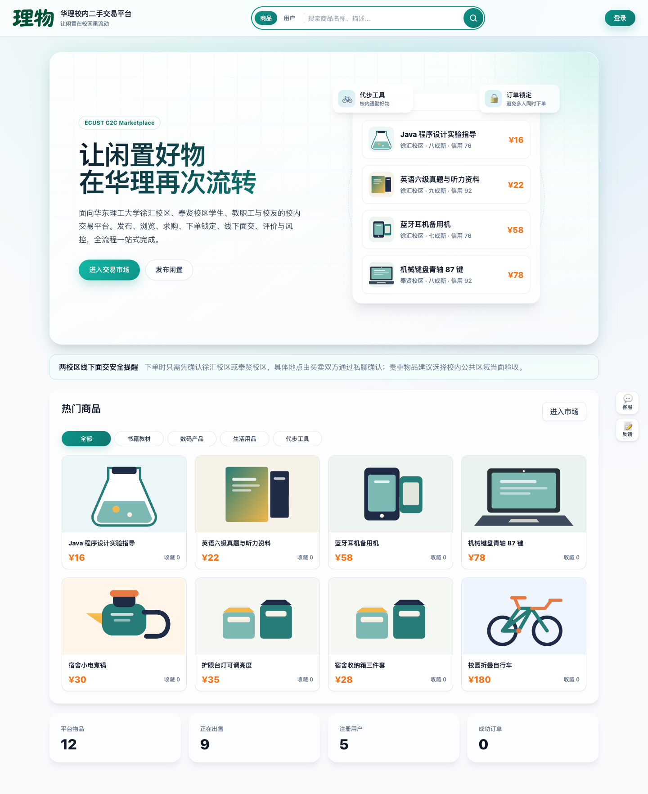

<details>
<summary>Marketplace and item details</summary>

### Marketplace

Browse items by keyword, category, campus, and sort order. View prices, item condition, seller credit scores, and availability.

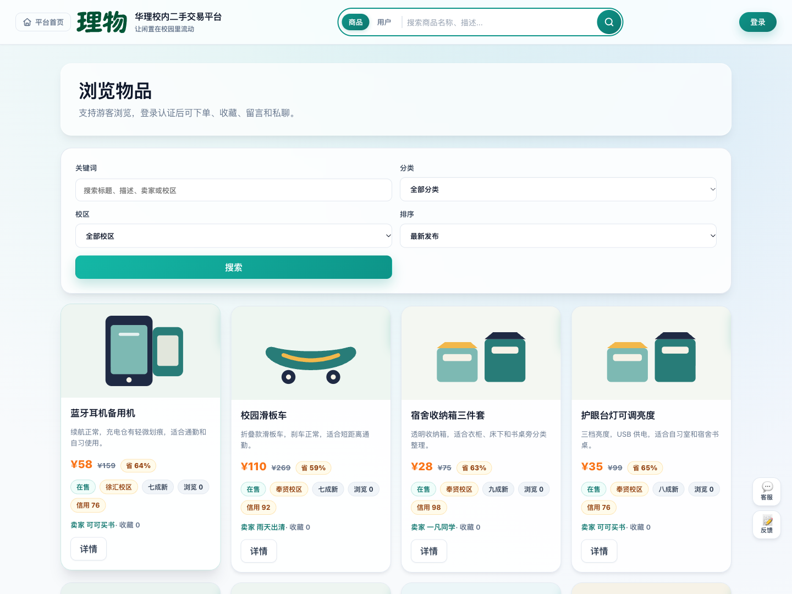

### Item Details

View item images, descriptions, seller information, and comments. Verified users can save favorites, place orders, or message sellers privately.

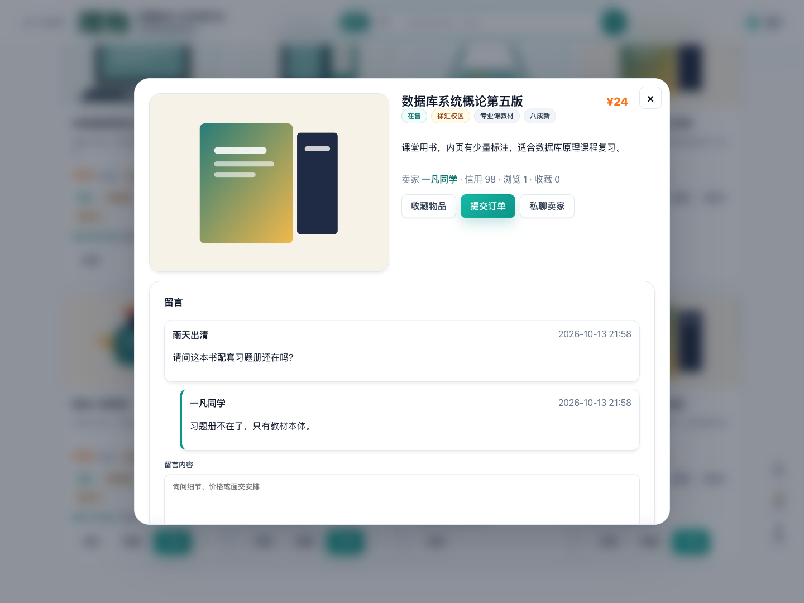

</details>

<details>
<summary>Sign-in and account center</summary>

### Sign-in

Access sign-in, registration, and password reset.

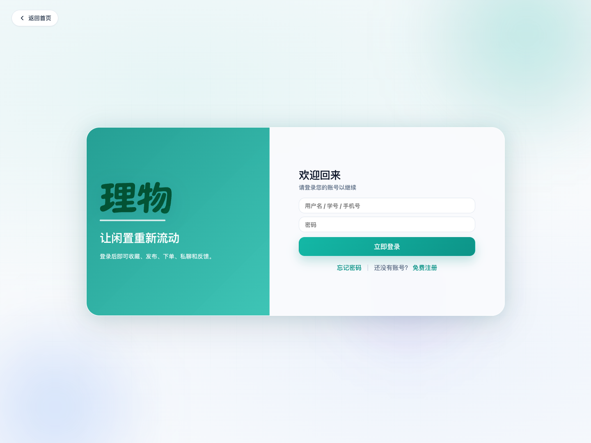

### Account Center

Access favorites, orders, private messages, notifications, and browsing history. Edit your profile and submit campus identity verification.

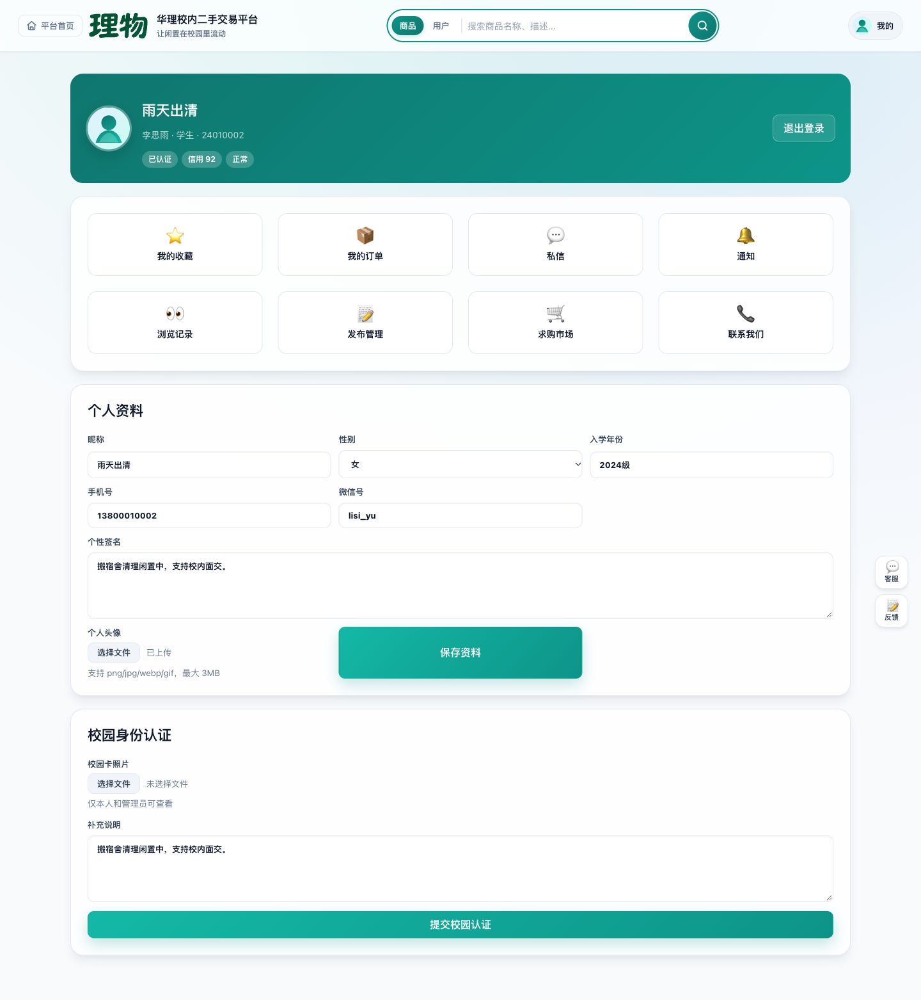

</details>

<details>
<summary>Listing management and wanted items</summary>

### Listing Management

Enter an item's category, campus, prices, condition, image, and description, and view your published listings.

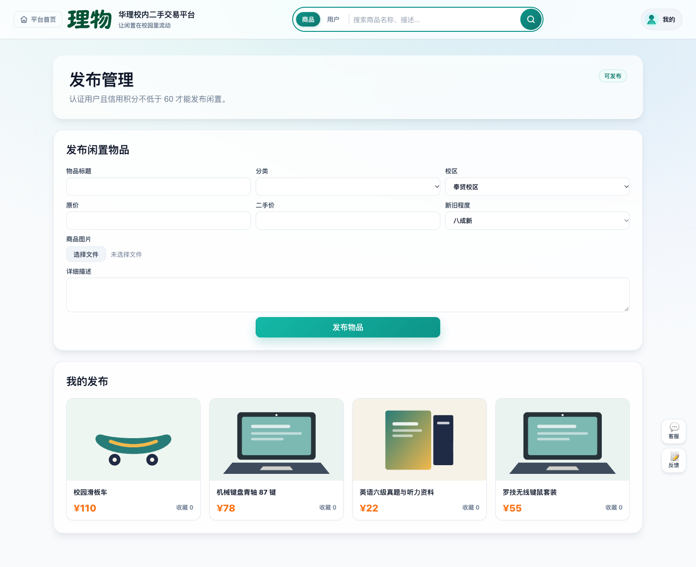

### Wanted Items

Post requests for items and browse request descriptions, target prices, and buyer information.

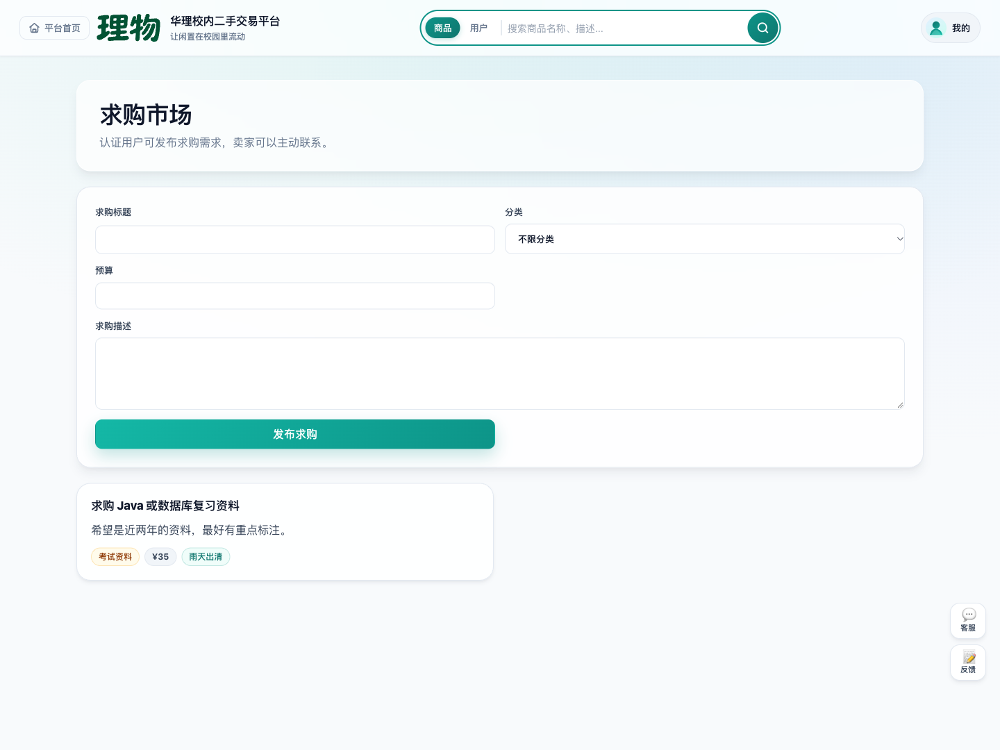

</details>

<details>
<summary>Orders and private messages</summary>

### My Orders

Distinguish purchases from sales, with transaction amounts, meetup arrangements, order statuses, and available actions.

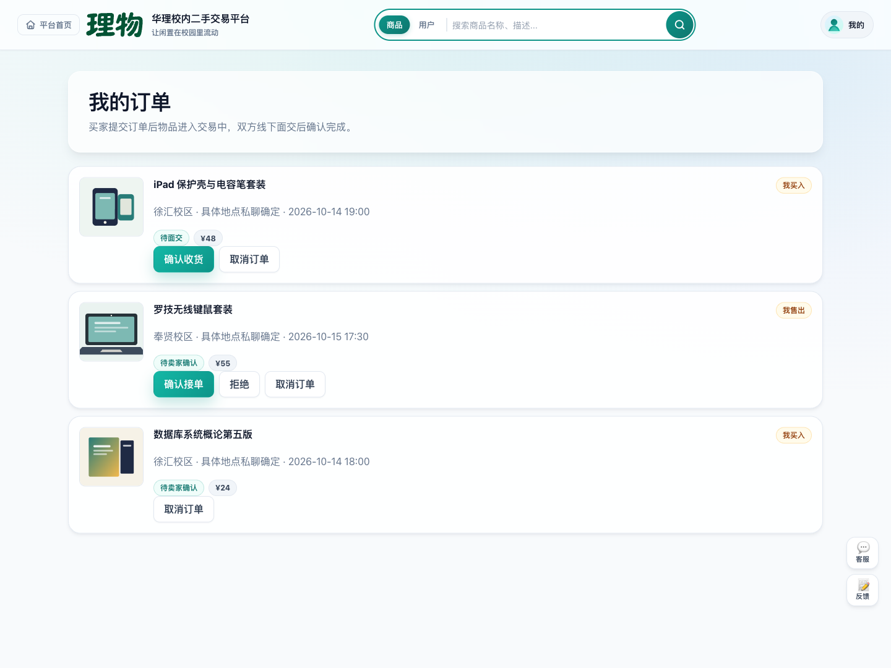

### Private Messages

Discuss item details with trading partners and confirm condition, meetup time, and location.

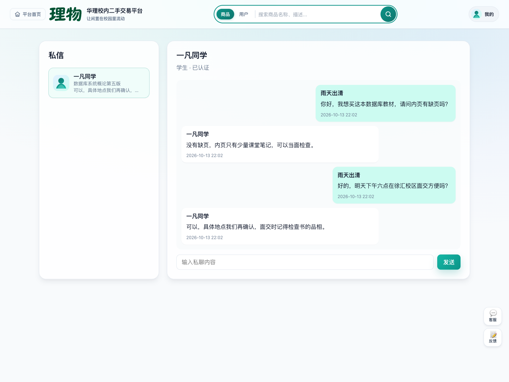

</details>

<details>
<summary>Admin dashboard</summary>

### Administration

View operational statistics, review campus identity verification requests, and manage user status.

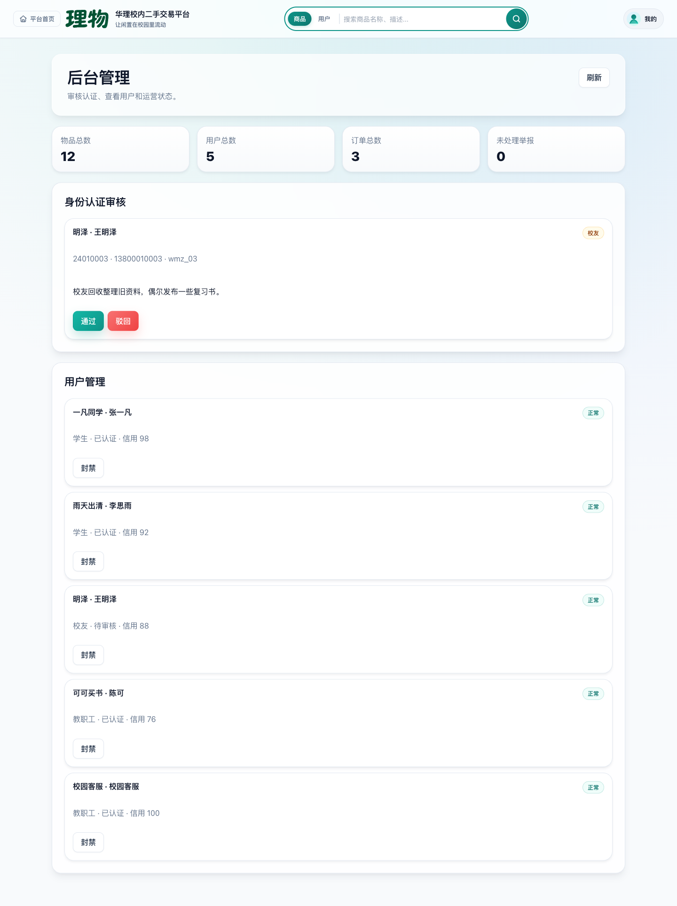

### Item Management

View platform items, sellers, and trading statuses, and remove inappropriate listings or those that violate platform rules.

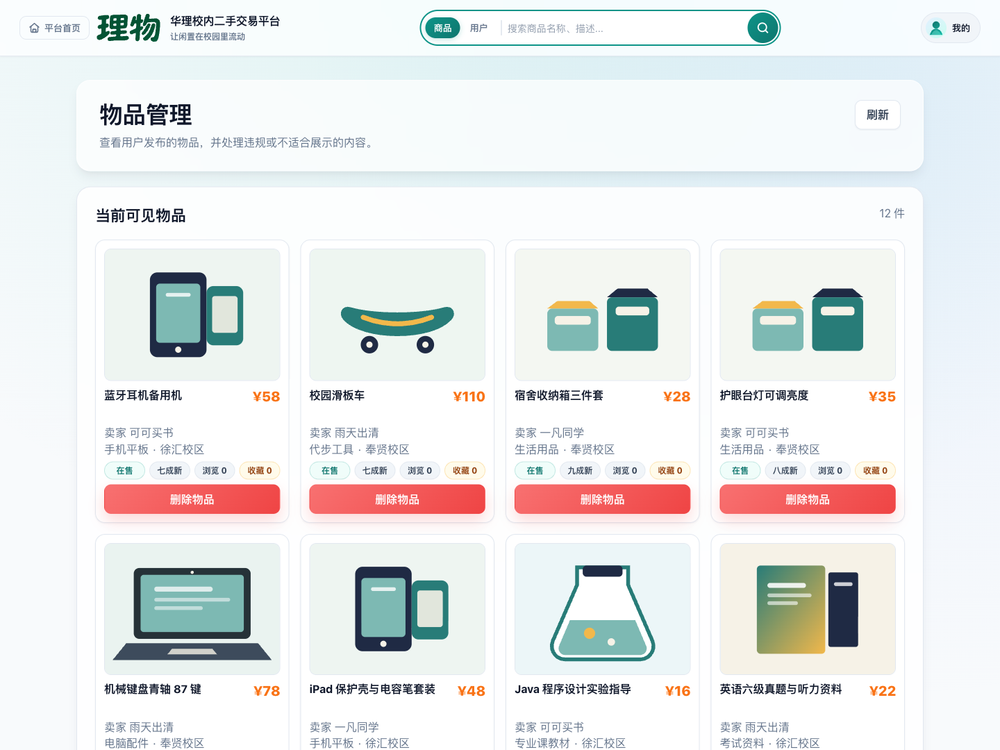

</details>

## Project Structure

```text
campus-market/
├── backend/
│   ├── app.py                # SQLite quick-test entry point; compatible with the legacy startup command
│   ├── app_mysql.py          # Recommended entry point: MySQL backend and static page server
│   ├── core.py               # Database connections, initialization, demo data, and shared validation utilities
│   ├── server.py             # HTTP server, static file serving, and application API routes
│   ├── schema.sql            # SQLite quick-test schema
│   └── schema_mysql.sql      # MySQL tables, indexes, triggers, views, and stored procedures
├── frontend/
│   ├── index.html            # Vite page entry point
│   ├── app.js                # Frontend logic for the unbuilt version
│   ├── styles.css            # Global styles for the unbuilt version
│   ├── package.json          # Vue 3 + Vite dependencies and scripts
│   ├── vite.config.js        # Vite development proxy configuration
│   ├── assets/               # Static SVG icons
│   ├── public/               # Static resources included in the frontend build
│   └── src/                  # Vue views, components, routing, state management, and API wrappers
├── scripts/
│   ├── smoke_sqlite.py       # SQLite smoke test
│   └── sync_mysql_to_sqlite.py  # MySQL → SQLite schema synchronization script
├── docs/screenshots/         # Interface screenshots used in the READMEs
├── requirements-mysql.txt    # Python dependencies for the MySQL backend
├── data/                     # Local SQLite runtime data; ignored by Git
├── output/                   # Local generated artifacts; ignored by Git
├── .gitignore
├── README.en.md              # English documentation
└── README.md                 # Chinese documentation
```

## Recommended Setup: MySQL

The MySQL backend requires access to a local or remote MySQL 8.0 server and the `PyMySQL` package:

```bash
python3 -m venv .venv-mysql
source .venv-mysql/bin/activate
python -m pip install -r requirements-mysql.txt
python backend/app_mysql.py
```

After startup, open:

```text
http://127.0.0.1:8001
```

Default connection settings:

```text
MYSQL_HOST=127.0.0.1
MYSQL_PORT=3306
MYSQL_USER=root
MYSQL_PASSWORD=123456
MYSQL_DATABASE=campus_market
MYSQL_CHARSET=utf8mb4
```

If your MySQL username or password differs, override the settings with environment variables:

```bash
MYSQL_USER=root MYSQL_PASSWORD=your_password python backend/app_mysql.py
```

## Frontend Development: Vue 3 + Vite

Install frontend dependencies before your first development session:

```bash
cd frontend
npm install
```

For frontend and backend development, start the SQLite or MySQL backend first, then start Vite:

```bash
npm run dev
```

Vite is available at:

```text
http://127.0.0.1:5173
```

`vite.config.js` proxies `/api` and `/uploads` to `http://127.0.0.1:8000`. When using the MySQL backend on port `8001`, temporarily change the proxy target or access the built frontend through the backend server.

Build the frontend:

```bash
cd frontend
npm run build
```

Build output is written to `frontend/dist/`. The Python backend prioritizes serving `frontend/dist/index.html`; the source directory remains available for frontend development when no build exists.

Before accessing the Python backend directly (SQLite on port `8000` or MySQL on port `8001` by default), run `npm run build` at least once to generate `frontend/dist/`. Without a frontend build, the backend displays a build instructions page instead of loading Vite source files directly.

## Quick Start: SQLite

The SQLite backend supports quick tests and lightweight validation without a separate database service:

```bash
python backend/app.py
```

After startup, open:

```text
http://127.0.0.1:8000
```

On the first run, the backend automatically executes `backend/schema.sql` and creates:

```text
data/campus_market.db
```

Uploaded avatars, item images, and campus card photos are stored in:

```text
data/uploads/
```

To reset the SQLite test data, stop the server, delete `data/campus_market.db`, and start the server again.

## Local Checks

The SQLite smoke test initializes a database in a temporary directory and checks core tables, views, demo accounts, and order triggers:

```bash
python3 scripts/smoke_sqlite.py
```

## Demo Accounts

Administrator:

```text
Account: admin
Password: admin123
```

Verified users:

```text
Account: 24010001
Password: 123456

Account: 24010002
Password: 123456
```

User awaiting verification:

```text
Account: 24010003
Password: 123456
```

## Implemented Features

- Guests can browse and search items, filter by category, and view wanted posts and announcements.
- Guests can search users by nickname and view public profiles showing identity verification, public listings, and item comments.
- Users can register, sign in, edit their avatar, gender, enrollment year, bio, phone number, and WeChat ID, and upload a campus card photo for identity verification.
- Verified users can publish, edit, and delist items. Delisting hides an item and serves as deletion.
- Verified users can save favorites, leave comments, post wanted requests, place and cancel orders, confirm receipt, and review transactions.
- Verified users can exchange private messages. The private messaging page periodically refreshes the active conversation.
- Signed-in users can submit suggestions and feedback to administrators through “Contact Us.”
- Sellers can accept, reject, and cancel orders.
- The system creates in-app notifications for orders, comments, reviews, private messages, identity verification decisions, report handling, and feedback replies.
- Administrators can review identity verification documents, view campus card photos, reply to feedback, maintain categories and trading campuses, handle reports, forcibly delist items, ban users, maintain announcements, and view operational statistics.

## MySQL Database Objects

The MySQL schema in `backend/schema_mysql.sql` contains 16 core application tables:

- `Admin`
- `User`
- `Category`
- `Location`
- `Item`
- `Favorite`
- `Wanted`
- `OrderSheet`
- `Message`
- `PrivateConversation`
- `PrivateMessage`
- `Review`
- `Report`
- `Feedback`
- `Announcement`
- `Notification`

Key views:

- `V_Item_Detail`: Consolidated item details.
- `V_Order_Summary`: Consolidated order management information.
- `V_Risky_User`: Alerts for users with problematic credit scores.

Key triggers:

- `trg_order_no_self_buy`: Prevents buyers from purchasing their own items.
- `trg_order_create_lock_item`: Marks an item as being traded when an order is created.
- `trg_order_update_success`: Marks an item as sold when its transaction succeeds.
- `trg_order_update_cancel`: Restores an item to its available status when an order is canceled.
- `trg_review_requires_success`: Allows reviews only for successful transactions.
- `trg_review_participant`: Restricts reviewers to the order's buyer and seller.
- `trg_review_credit`: Automatically updates the reviewed user's credit score after a review.

Key stored procedure:

- `sp_system_health`: Returns database connectivity, current time, database name, and counts of users, items, and orders.

## Database Versions

The project supports both MySQL and SQLite implementations. MySQL is recommended for production, with full support for relational schemas, integrity constraints, indexes, views, triggers, and stored procedures. SQLite is intended for quick local tests and lightweight validation. Database schema maintenance uses `backend/schema_mysql.sql` as the authoritative production script, while `backend/schema.sql` retains an equivalent structure for local testing.

## Local Files

`.gitignore` excludes local virtual environments, runtime databases, Python caches, editor settings, and local tool state. Database files created while running the project do not need to be committed.

## License

This project is licensed under the [MIT License](LICENSE).
